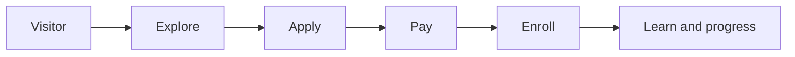
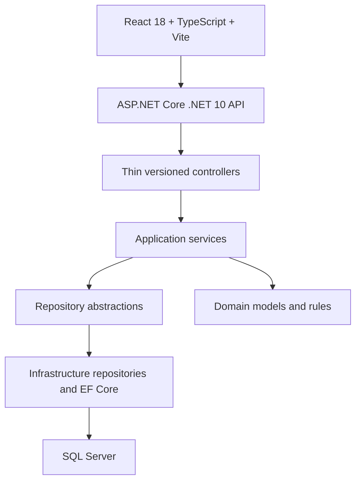
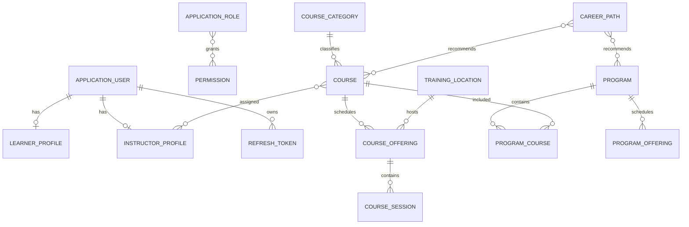
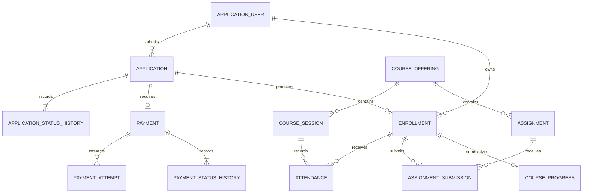
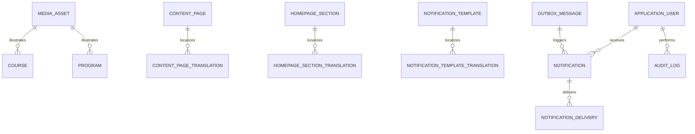
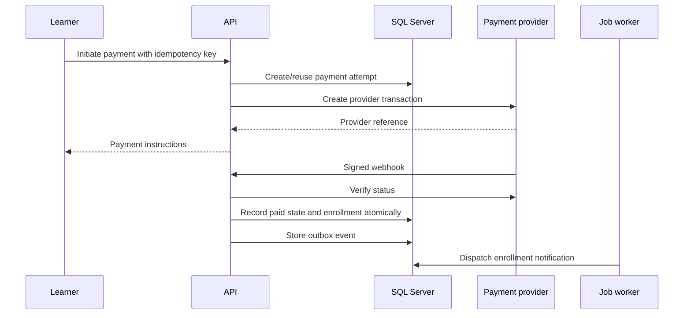

# Andalusia Academy Phase 1 MVB

## Development setup and running

For a complete Docker, backend, frontend, migration, and SQL Server walkthrough, see [Local Development Guide](docs/LOCAL_DEVELOPMENT.md).

The API requires a local `DefaultConnection` whenever it uses the database. Follow the guide's Docker Compose or Visual Studio workflow before starting the API; do not commit database passwords.

### Prerequisites

- .NET 10 SDK
- Node.js `20.19+` or `22.12+`
- Git
- A trusted ASP.NET Core HTTPS development certificate
- Docker Desktop only when using the Docker Compose setup

Trust the local HTTPS certificate once:

```powershell
dotnet dev-certs https --trust
```

### Run directly with .NET

From the repository root, restore and build the solution:

```powershell
dotnet restore AndalusiaAcademy.sln
dotnet build AndalusiaAcademy.sln --configuration Release --no-restore
```

Run the API with HTTPS:

```powershell
dotnet run --project src\AndalusiaAcademy.API --launch-profile https
```

The HTTPS launch profile uses:

- Swagger UI: `https://localhost:7115/swagger`
- OpenAPI document: `https://localhost:7115/openapi/v1.json`
- Health check: `https://localhost:7115/health`
- Versioned ping endpoint: `https://localhost:7115/api/v1/ping`
- HTTP fallback: `http://localhost:5032`

The `http` launch profile can be used without HTTPS:

```powershell
dotnet run --project src\AndalusiaAcademy.API --launch-profile http
```

Its Swagger UI is available at `http://localhost:5032/swagger`.

Stop the API with `Ctrl+C`. Do not run the Visual Studio and PowerShell profiles at the same time because they use the same ports.

### Run from Visual Studio

1. Open `AndalusiaAcademy.sln`.
2. Set `AndalusiaAcademy.API` as the startup project.
3. Select the `https` profile.
4. Press `F5` or `Ctrl+F5`.

Visual Studio opens Swagger UI automatically.

### Run the frontend

Open a second PowerShell terminal from the repository root, install the locked dependencies, and start Vite:

```powershell
Set-Location frontend
npm ci
npm run dev
```

The frontend is available at `http://localhost:5173` and connects to the HTTPS API at `https://localhost:7115` by default.

To connect the frontend to another API URL, create an ignored local configuration file:

```powershell
Copy-Item .env.example .env.local
```

Then update `VITE_API_BASE_URL` in `frontend/.env.local`. For example, use `http://localhost:8080` when the API is running through Docker Compose. Restart the Vite development server after changing an environment variable.

### Run with Docker Compose

Create the ignored local environment file from the supplied example:

```powershell
Copy-Item .env.example .env
```

The example uses `Aa11!Andalusia` for local SQL Server development. Replace it with your own strong local password when needed. Never commit `.env`.

Before starting Compose, generate the required local JWT signing key using the command in [Local Development Guide section 2](docs/LOCAL_DEVELOPMENT.md#2-create-the-local-docker-configuration). The key is stored only in the ignored `.env` file.

Start the API and SQL Server:

```powershell
docker compose up --build
```

Docker URLs use port `8080` by default:

- Swagger UI: `http://localhost:8080/swagger`
- Health check: `http://localhost:8080/health`
- Versioned ping endpoint: `http://localhost:8080/api/v1/ping`

After the EF Core migrations have been applied, the Development API inserts any missing catalog demo records when it starts. Existing catalog records are preserved, and this seeding does not run outside Development.

To use different host ports, change `API_HTTP_PORT` and `SQLSERVER_PORT` in `.env`. Stop the stack with:

```powershell
docker compose down
```

### Run automated checks

Run the backend test suite from the repository root:

```powershell
dotnet test AndalusiaAcademy.sln --configuration Release
```

Run the frontend lint, production build, and test suite from the repository root:

```powershell
Set-Location frontend
npm ci
npm run lint
npm run build
npm test
```

## Stage 0 — Requirements and Architecture Analysis

This document consolidates the Stage 0 architecture analysis for the Andalusia Academy Phase 1 MVB based on:

- The Phase 1 MVB Feature Scope
- The Phase 1 Technical Architecture & Engineering Plan v2
- The Master Project Prompt

No implementation code is included in this stage.

## 1. Project understanding

Andalusia Academy Phase 1 is an end-to-end bilingual academy platform, not merely a course catalog.

It must support this complete journey:



A successful Phase 1 means:

- Visitors can discover courses, programs, career paths, instructors, and academy information.
- Users can register, confirm their accounts, log in, apply, pay, and become enrolled.
- Learners can access schedules, materials, assignments, attendance, and progress.
- Instructors can manage their assigned courses, students, sessions, attendance, and assignments.
- Managers and administrators can operate the academy.
- Content managers can maintain public content.
- Important events produce reliable notifications.
- Security, permissions, historical integrity, and payment safety are built into the design.

## 2. Source conflicts and overrides

| Area | Technical architecture | Final decision |
|---|---|---|
| Backend version | ASP.NET Core 8 | **ASP.NET Core/.NET 10** |
| Frontend framework | React 18 with Vite or Next.js | **React 18 + TypeScript + Vite only** |
| Architecture | Clean Architecture + CQRS | **Pragmatic Clean Architecture with application services and repositories** |
| Application style | Modular monolith | Confirmed |
| Database | SQL Server | Confirmed |
| Application flow | MediatR commands and queries | **Controller → Service → Repository → EF Core** |
| Redis | Presented as part of the locked stack | Introduce only when caching, distributed rate limiting, or idempotency justifies it |
| Hangfire | Presented as a core component | Introduce when notifications, reminders, or outbox dispatch require it |
| Blob/CDN | Production architecture assumes Azure Blob and CDN | Local storage abstraction first; Azure Blob/CDN during deployment work |
| Notifications | Architecture expects email and SMS | Implement only stakeholder-approved channels |
| Secret storage | Architecture says Azure Key Vault | User Secrets locally, secure environment/deployment configuration outside production, Key Vault in production |
| Health/observability | Architecture treats them as first-class | Design for them now; implement fully during production-readiness stages |
| Refresh tokens | Redis or secure cookie suggested | Transport and persistence must be designed separately before implementation |
| Future extraction | Architecture suggests modules can be extracted without restructuring | Boundaries will reduce future work, but zero restructuring cannot be guaranteed |

The Feature Scope does not conflict materially with the Master Prompt. The prompt mainly adds engineering constraints, security standards, and clearer Phase 1 boundaries.

Confirmed stack:

- .NET 10
- ASP.NET Core Web API
- EF Core and SQL Server
- React 18
- TypeScript
- Vite
- Pragmatic Clean Architecture
- Application services and repository abstractions
- Modular monolith
- FluentValidation
- Swagger/OpenAPI

## 3. Requirement breakdown

| Area | Phase 1 responsibilities |
|---|---|
| Public | Homepage, About, catalog, course/program details, career paths, instructor profiles, partners, accreditations, testimonials, FAQ, comparison, contact, business information, search and filtering |
| Learner | Profile, applications, payments, enrollments, courses, programs, sessions, materials, attendance, assignments, progress, support |
| Instructor | Assigned courses, learners, sessions, attendance, assignments, submissions, course progress, learner information, earnings |
| Manager/Admin | KPIs, students, instructors, courses, schedules, applications, payments, enrollments, reports, compensation, payouts, activity, roles and permissions |
| Content Management | Homepage, public pages, courses, programs, career paths, profiles, FAQs, partners, accreditations, media, schedules, statuses |
| Notifications | Account, application, payment, enrollment, reminders, announcements, assignments, instructor assignment, operational notifications |
| Identity/Security | Registration, confirmation, login, reset, JWT, refresh tokens, roles, permissions, auditing, rate limiting |
| Infrastructure | SQL Server, media storage, background jobs, caching, outbox, health checks, logging, observability, deployment and CI/CD |

## 4. Phase 1 versus future phases

### Build in Phase 1

- Public website and searchable catalog
- Offline course details
- Programs and career paths
- Identity and profile management
- Application, admission, payment, and enrollment foundation
- Learner, instructor, manager, admin, and content dashboards
- Sessions and offline locations
- Course materials
- Attendance
- Basic assignments and submissions
- Course progress
- Compensation and payout records
- Roles and granular permissions
- Approved notification channels

### Do not build in Phase 1

- Direct instructor–learner messaging
- Conversation threads
- Advanced calendar platform
- Quizzes and assessments
- Question banks
- Grading engine
- Certificates
- AI assessment or learning assistant
- AI recommendations
- Gamification
- Advanced learner-risk analytics
- Corporate accounts or employee management
- Bulk corporate enrollment
- Alumni and career-services platform
- Community features
- Advanced marketing automation
- Advanced personalization

The public “For Business” page is informational only. It does not authorize the Phase 4 Corporate Academy platform.

## 5. Proposed system architecture



Cross-cutting placement:

| Capability | Placement |
|---|---|
| Identity | Infrastructure persistence and API authentication configuration |
| JWT | API token validation; Infrastructure token creation/persistence |
| Refresh tokens | Infrastructure persistence; secure HTTP transport through API |
| Validation | Application services using FluentValidation at request boundaries |
| Authorization | API policies backed by application permission requirements |
| Logging | API and Infrastructure structured logging |
| Audit | Application abstraction with Infrastructure persistence |
| Redis | Infrastructure adapter introduced when needed |
| Hangfire | Infrastructure background processing |
| Outbox | Application abstraction and Infrastructure persistence/dispatcher |
| Notifications | Separate logical module triggered by application/domain events |
| Payment | Application gateway interface with Infrastructure provider adapter |
| File storage | Application abstraction with local/Azure implementations |
| Localization | React i18n plus localized API/content models |
| Observability | API, EF Core, cache, jobs, and external HTTP instrumentation |

Controllers will not call EF Core directly. Application services contain use-case logic and depend on repository interfaces implemented by Infrastructure. ASP.NET Core Identity uses its built-in managers and stores rather than redundant repositories.

## 6. Clean Architecture solution structure

```text
AndalusiaAcademy/
├── AndalusiaAcademy.sln
├── src/
│   ├── AndalusiaAcademy.Domain/
│   │   ├── Common/
│   │   └── Models/
│   ├── AndalusiaAcademy.Application/
│   │   ├── DTOs/
│   │   ├── Repositories/
│   │   ├── Services/
│   │   ├── Validation/
│   │   └── Exceptions/
│   ├── AndalusiaAcademy.Infrastructure/
│   │   ├── Data/
│   │   │   └── Migrations/
│   │   ├── Repositories/
│   │   ├── Identity/
│   │   ├── Payments/
│   │   ├── Notifications/
│   │   ├── Storage/
│   │   ├── BackgroundJobs/
│   │   └── Caching/
│   └── AndalusiaAcademy.API/
│       ├── Controllers/
│       ├── Authorization/
│       ├── Middleware/
│       ├── OpenApi/
│       ├── HealthChecks/
│       └── DependencyInjection/
├── frontend/
│   └── andalusia-academy-web/
└── tests/
    ├── AndalusiaAcademy.Domain.UnitTests/
    ├── AndalusiaAcademy.Application.UnitTests/
    └── AndalusiaAcademy.API.IntegrationTests/
```

Project dependency direction:

```text
Domain             → no project dependency
Application        → Domain
Infrastructure     → Application + Domain
API                → Application + Infrastructure
```

## 7. Final Phase 1 modules

| Module | Ownership |
|---|---|
| Catalog | Courses, programs, career paths, offerings, sessions, locations, instructors, public discovery |
| Identity | Users, registration, authentication, profiles, roles, permissions, refresh tokens |
| Enrollment | Applications, admission state, payments, enrollment, idempotency |
| LMS Core | Learner access, materials, attendance, assignments, submissions, progress |
| Operations | Dashboards, KPIs, user operations, schedules, compensation, payouts, reports |
| CMS | Homepage, pages, FAQ, testimonials, partners, accreditations, publishing and media |
| Notifications | Templates, in-app notifications, delivery attempts, reminders |
| Cross-cutting platform | Audit, outbox, storage, logging, caching, current user, time provider |

No separate microservice or database will be created for these modules in Phase 1.

## 8. Database design

### General decisions

- Use `Guid` identifiers for business entities, generated in an index-friendly manner.
- Store business and audit timestamps as UTC `DateTimeOffset`.
- Use `decimal(18,2)` and three-character currency codes for money.
- Keep Arabic and English content in entity-specific translation tables.
- Use JSON only for ordered presentation content that is not searched relationally, such as objective bullet lists.
- Never store uploaded binary files in SQL Server.
- Preserve historical payment, enrollment, attendance, and progress records.
- Apply unique constraints and check constraints in SQL Server, not only application validation.

### Identity

| Entity | Purpose and important fields | Keys, constraints, lifecycle |
|---|---|---|
| `ApplicationUser` | Identity account, name, email, phone, country, preferred language, consent timestamp | PK `Id`; unique normalized email; PII; never soft-delete blindly—disable/anonymize |
| `LearnerProfile` | Learner-specific profile information | PK/FK `UserId`; one-to-one with user; sensitive |
| `InstructorProfile` | Bio, headline, expertise, image, publishing state | PK/FK `UserId`; optional media FK; soft-deletable/unpublishable |
| `InstructorProfileTranslation` | Arabic/English bio and public profile text | Unique `(InstructorProfileId, LanguageCode)` |
| `ApplicationRole` | ASP.NET Core Identity role | Unique normalized name |
| `Permission` | Stable permission code and description | Unique `Code` |
| `RolePermission` | Many-to-many role/permission link | Composite PK `(RoleId, PermissionId)` |
| `RefreshToken` | Hashed rotating token, family, expiry, revocation and replacement | FK `UserId`; index token hash/family/user; security-sensitive; never store raw token |

ASP.NET Core Identity will also create its normal user-role, claim, login, and token tables.

### Catalog and scheduling

| Entity | Purpose and important fields | Keys, constraints, lifecycle |
|---|---|---|
| `CourseCategory` | Course classification | Unique slug; active flag; referenced categories are deactivated rather than deleted |
| `Course` | Course identity, category, type, status, duration, image, publish metadata | FK category/media; indexes status/category/deleted; soft delete |
| `CourseTranslation` | Title, short/full description, objectives, SEO text | Unique `(CourseId, LanguageCode)`; required Arabic and English before publishing |
| `CourseInstructor` | Many-to-many course/instructor assignment | Composite unique course/instructor; optional “lead instructor” constraint |
| `TrainingLocation` | Branch, room, address and map information | Indexed active state/city; physical location data |
| `CourseOffering` | A scheduled sellable run/cohort of a course | FKs course/location; dates, price, currency, capacity, application window, status; indexes course/status/start date |
| `CourseSession` | Individual class session | FK offering/instructor/location; start/end; index offering/date |
| `ProgramCategory` | Program classification | Unique slug; active flag |
| `Program` | Program identity, category, career information and status | FK category/media; status and soft-delete indexes |
| `ProgramTranslation` | Title, overview, requirements, structure and SEO text | Unique `(ProgramId, LanguageCode)` |
| `ProgramCourse` | Ordered courses included in a program | Composite unique program/course; sequence and required flag |
| `ProgramOffering` | Scheduled sellable program cohort | FKs program/location; dates, price, capacity and application window |
| `CareerPath` | Career-path identity and publishing state | Unique slug; soft delete |
| `CareerPathTranslation` | Overview, recommended skills and journey content | Unique `(CareerPathId, LanguageCode)` |
| `CareerPathProgram` | Recommended/related programs | Composite unique relationship; sort order |
| `CareerPathCourse` | Recommended/related standalone courses | Composite unique relationship; sort order |

> ⚠ **BUSINESS RULE TO CONFIRM:** Whether related courses/programs are calculated by category or manually curated. Separate relationship tables should only be added if manual curation is required.

### Applications, payments, and enrollment

| Entity | Purpose and important fields | Keys, constraints, lifecycle |
|---|---|---|
| `Application` | Learner application to a course or program offering | FK applicant plus exactly one course/program offering; status, submitted date, correlation ID; indexed applicant/status/target |
| `ApplicationStatusHistory` | Immutable application status transitions | FK application and changed-by user; timestamp/reason |
| `Payment` | Payment obligation linked to an accepted application | FK application/user; amount, currency, status, correlation/idempotency key; no card data |
| `PaymentAttempt` | Each provider initiation/attempt | FK payment; provider, provider reference, status, timestamps; unique provider reference/idempotency key |
| `PaymentStatusHistory` | Immutable payment transitions | FK payment/attempt; source, timestamp, safe provider metadata |
| `PaymentWebhookReceipt` | Retry-safe webhook inbox | Unique provider event ID; signature verification result, processing state, payload hash |
| `Enrollment` | Learner’s durable access relationship | FK application/user and target offering; status, enrolled/completed/cancelled dates; preserve history |
| `IdempotencyRecord` | Durable result for protected write operations | Unique `(Scope, Key)`; request hash, response reference, expiry |

Application and enrollment targeting will use database check constraints so exactly one course or program offering is selected.

An enrollment should never be physically deleted. If suppression is required, it may receive an administrative soft-delete flag while retaining its lifecycle status and audit history.

### LMS Core

| Entity | Purpose and important fields | Keys, constraints, lifecycle |
|---|---|---|
| `CourseMaterial` | Metadata for documents/resources | FK course and optional session/media; type, sort order, visibility |
| `Attendance` | Attendance for one enrolled learner at one session | FKs session/enrollment/marked-by user; unique `(SessionId, EnrollmentId)`; audit edits |
| `Assignment` | Basic assignment for an offering/session | FK offering and optional session; title, instructions, due date, publishing state |
| `AssignmentSubmission` | Learner submission | FKs assignment/enrollment; submitted date, text/status; unique assignment/enrollment unless resubmission is approved |
| `SubmissionAttachment` | Links a submission to stored media | Composite relationship with media asset |
| `MaterialProgress` | Learner material access/completion | Unique `(EnrollmentId, CourseMaterialId)` |
| `SessionProgress` | Session-level completion record where attendance alone is insufficient | Unique `(EnrollmentId, CourseSessionId)` |
| `CourseProgress` | Dashboard-friendly course progress summary | Unique enrollment; percentage/status/calculation version |

> ⚠ **BUSINESS RULE TO CONFIRM:** The exact progress formula. `CourseProgress` must not be calculated permanently until attendance, assignment, session, and material weighting is approved.

### Operations and CMS

| Entity | Purpose and important fields | Keys, constraints, lifecycle |
|---|---|---|
| `InstructorCompensation` | Approved earning associated with instructor/offering | FKs instructor/offering; amount, currency, status; highly sensitive |
| `Payout` | Payout batch or payment record | FK instructor; total, currency, status, approved/paid timestamps |
| `PayoutLineItem` | Connects compensation records to a payout | Unique compensation assignment; preserves financial history |
| `MediaAsset` | Storage key, type, size, checksum, ownership and metadata | Unique storage key; soft delete; no binary content |
| `ContentPage` | Fixed pages such as About, For Business, Contact and Support | Unique page key/slug; status and publish date |
| `ContentPageTranslation` | Bilingual page title/body/SEO | Unique `(PageId, LanguageCode)` |
| `HomepageSection` | Explicit Phase 1 homepage sections | Section type, order, enabled/published state |
| `HomepageSectionTranslation` | Bilingual section content | Unique section/language |
| `Partner` | Partner logo, link and display order | Media FK; active/published state |
| `Accreditation` | Accreditation details and media | Publishing state; date fields where applicable |
| `FAQ` | Ordered FAQ record | Category, order and publishing state |
| `FAQTranslation` | Localized question and answer | Unique FAQ/language |
| `Testimonial` | Approved testimonial and attribution | Media FK; publishing state and consent evidence where needed |
| `SiteSetting` | Contact details, supported social links and safe public settings | Unique setting key; secrets forbidden |

Dashboards and KPIs should initially query operational data. Separate KPI tables are unnecessary until reporting performance proves they are needed.

### Notifications and audit

| Entity | Purpose and important fields | Keys, constraints, lifecycle |
|---|---|---|
| `NotificationTemplate` | Stable notification type and allowed channels | Unique template code; active state |
| `NotificationTemplateTranslation` | Arabic/English subject and body | Unique template/language/channel |
| `Notification` | Logical notification for a recipient | FK user/template; event type, data, read date |
| `NotificationDelivery` | Email/SMS/in-app delivery attempt and status | FK notification; channel, attempt count, provider reference |
| `OutboxMessage` | Transactionally persisted asynchronous event | Status, type, payload, occurred/processed dates; index pending messages |
| `AuditLog` | Immutable sensitive-action record | Actor, action, entity, correlation ID, safe before/after metadata; time indexes |

## 9. Text-based ERD

### Identity and catalog



### Enrollment and LMS



### CMS, notifications, and reliability



## 10. Proposed roles and permission matrix

This is a starting matrix, not stakeholder-approved authorization.

| Capability | Learner | Instructor | Manager | Admin | Content Manager |
|---|---:|---:|---:|---:|---:|
| View public catalog | Yes | Yes | Yes | Yes | Yes |
| Manage own profile | Own | Own | Own | Own | Own |
| Apply, pay, enroll | Own | — | Assisted view | Full oversight | — |
| View learner courses/LMS | Own | Assigned learners | View/manage | Full | — |
| Manage attendance | View own | Assigned courses | Yes | Yes | — |
| Manage assignments | Submit | Assigned courses | Oversight | Yes | — |
| View instructor earnings | — | Own | With permission | With permission | — |
| Manage courses/programs | — | Assigned operational access | Yes | Yes | Content fields |
| Publish catalog content | — | — | Optional permission | Yes | Yes |
| Manage students/instructors | — | View assigned learners | Yes | Yes | — |
| Review applications | — | — | With permission | Yes | — |
| Manage payments/enrollments | Own view | — | With permission | Yes | — |
| View KPIs/reports | — | Own dashboard | Yes | Yes | Limited content metrics |
| Manage compensation | — | Own view | Separate permission | Separate permission | — |
| Manage roles/permissions | — | — | Normally no | Yes | — |
| Manage notifications | Own preferences/read | Assigned announcements | Operational | Full | Template/content permission |

> ⚠ **BUSINESS RULE TO CONFIRM:**
>
> - Exact Manager versus Admin boundaries
> - Whether Managers can assign roles
> - Who reviews applications
> - Who may correct attendance
> - Who may approve compensation and payouts
> - Whether Content Managers may change prices, schedules, or enrollment status

Authorization will be permission-policy based. Roles merely receive permission collections.

## 11. API plan

All routes are proposed under `/api/v1`.

### Identity

- `POST /auth/register`
- `POST /auth/confirm-email`
- `POST /auth/resend-confirmation`
- `POST /auth/login`
- `POST /auth/refresh`
- `POST /auth/logout`
- `POST /auth/forgot-password`
- `POST /auth/reset-password`
- `GET /auth/me`
- `PUT /auth/me`

### Public catalog and content

- `GET /courses`
- `GET /courses/{slug}`
- `GET /course-categories`
- `GET /programs`
- `GET /programs/{slug}`
- `GET /programs/compare`
- `GET /program-categories`
- `GET /career-paths`
- `GET /career-paths/{slug}`
- `GET /instructors/{id-or-slug}`
- `GET /homepage`
- `GET /pages/{slug}`
- `GET /partners`
- `GET /accreditations`
- `GET /faqs`
- `GET /testimonials`
- `GET /search`

### Applications, payments, and enrollment

- `POST /applications`
- `GET /applications/mine`
- `GET /applications/{id}`
- `GET /admin/applications`
- `PATCH /admin/applications/{id}/status`
- `POST /payments`
- `GET /payments/mine`
- `GET /payments/{id}`
- `POST /payments/webhooks/{provider}`
- `GET /enrollments/mine`
- `GET /enrollments/{id}`

Cancellation, refunds, manual enrollment, and administrative payment changes remain unresolved.

### Learner and LMS

- `GET /learner/dashboard`
- `GET /learner/courses`
- `GET /learner/programs`
- `GET /learner/upcoming-sessions`
- `GET /learner/enrollments/{id}/materials`
- `GET /learner/enrollments/{id}/attendance`
- `GET /learner/enrollments/{id}/assignments`
- `POST /learner/assignments/{id}/submissions`
- `GET /learner/enrollments/{id}/progress`

### Instructor

- `GET /instructor/dashboard`
- `GET /instructor/courses`
- `GET /instructor/courses/{id}/students`
- `GET /instructor/sessions`
- `PUT /instructor/sessions/{id}/attendance`
- `POST /instructor/courses/{id}/assignments`
- `PUT /instructor/assignments/{id}`
- `GET /instructor/assignments/{id}/submissions`
- `GET /instructor/earnings`

### Operations and administration

- `GET /admin/dashboard`
- `GET /admin/students`
- `GET /admin/instructors`
- `GET /admin/reports`
- `GET /admin/activity`
- `GET /admin/compensation`
- `POST /admin/compensation`
- `GET /admin/payouts`
- `POST /admin/payouts`
- `GET /admin/roles`
- `POST /admin/roles`
- `PUT /admin/roles/{id}/permissions`
- `GET /admin/permissions`

### CMS

- CRUD and publish endpoints for:
  - Courses
  - Programs
  - Career paths
  - Instructors
  - Homepage sections
  - Public pages
  - FAQs
  - Partners
  - Accreditations
  - Testimonials
  - Media
  - Locations and schedules

Publishing should be a separate permission and action from editing.

### Notifications

- `GET /notifications`
- `PATCH /notifications/{id}/read`
- `PATCH /notifications/read-all`
- Management endpoints for approved templates and operational announcements

## 12. Application service plan

| Module | Service operations | Read operations |
|---|---|---|
| Identity | RegisterUser, ConfirmEmail, Login, RefreshToken, RevokeRefreshToken, RequestPasswordReset, ResetPassword, UpdateProfile | GetCurrentUser, GetUserPermissions |
| Catalog | Create/Update/Archive/PublishCourse, CreateCourseOffering, ScheduleCourseSession, Create/UpdateProgram, Create/UpdateCareerPath | GetCourses, GetCourseDetails, GetPrograms, GetProgramDetails, GetCareerPaths, GetPublicSearch |
| Enrollment | SubmitApplication, ReviewApplication, InitiatePayment, ProcessPaymentWebhook, ConfirmPayment, CreateEnrollment | GetMyApplications, GetApplication, GetMyPayments, GetEnrollment |
| LMS | UploadCourseMaterial, RecordAttendance, CorrectAttendance, CreateAssignment, SubmitAssignment, UpdateProgress | GetLearnerDashboard, GetCourseMaterials, GetAttendance, GetAssignments, GetCourseProgress |
| Operations | AssignInstructor, CreateCompensation, ApprovePayout, UpdateRolePermissions | GetInstructorDashboard, GetAdminDashboard, GetStudents, GetInstructors, GetReports, GetRecentActivity |
| CMS | UpdatePage, UpdateHomepageSection, PublishContent, UploadMedia, ManageFAQ/Partner/Accreditation | GetCmsContent, GetContentPreview |
| Notifications | CreateAnnouncement, MarkNotificationRead, DispatchNotification | GetNotifications, GetDeliveryStatus |

Validators handle input shape and boundaries. Application services enforce use-case rules and coordinate repository operations. Domain models enforce invariants that must remain true regardless of the caller.

## 13. Payment and enrollment design



Important boundaries:

- Application, payment, and enrollment remain separate concepts.
- Payment initiation is idempotent.
- Provider events have a unique provider event/reference constraint.
- The client cannot mark a payment as paid.
- Webhook signatures must be validated.
- Payment confirmation and enrollment creation should share a database transaction where possible.
- Enrollment uniqueness provides a second defence against duplicate webhook processing.
- Notification failure must not roll back a completed enrollment.
- The outbox stores the notification-triggering event in the same transaction.
- Background consumers must be idempotent.

> ⚠ **BUSINESS RULE TO CONFIRM:**
>
> - Application and admission states
> - Whether every application requires manual review
> - Whether payment happens before or after admission
> - Free offerings
> - Deposits or instalments
> - Capacity reservation timing
> - Refunds and cancellations
> - Re-enrollment
> - Program enrollment effects on included courses
> - Final payment provider

## 14. Query and scalability plan

| Area | Approach |
|---|---|
| Catalog listing | `Where → OrderBy → Select → Skip → Take` in SQL |
| Catalog details | DTO projection through navigation relationships; avoid tracked graphs |
| Related data | Join/projection only for required fields; no blanket `Include` |
| Dashboards | SQL aggregation and grouped projections; no per-row follow-up queries |
| Pagination | Page and page-size bounds with stable deterministic ordering |
| Search | Indexed normalized fields initially; dedicated search service only if needed later |
| Indexes | Status/category/date/FK indexes aligned with actual list and dashboard queries |
| Catalog cache | Redis cache-aside with short TTL and invalidation after publishing |
| User dashboard cache | Optional short per-user cache after correctness is established |
| Transactions | Payments, enrollment, status changes, payouts, and outbox writes |
| Background work | Notification delivery, reminders, retries, outbox dispatch |
| Media | Storage abstraction; Blob Storage and CDN in production |
| Reports | SQL projections first; read replica only if reporting competes with transactions |

Authorization and ownership filters must be applied before returning projected data.

## 15. Frontend architecture

```text
src/
├── api/
│   ├── client.ts
│   ├── queryKeys.ts
│   └── errorHandling.ts
├── components/
├── features/
│   ├── auth/
│   ├── catalog/
│   ├── courses/
│   ├── programs/
│   ├── careerPaths/
│   ├── applications/
│   ├── payments/
│   ├── enrollments/
│   ├── learner/
│   ├── instructor/
│   ├── admin/
│   ├── content/
│   └── notifications/
├── hooks/
├── layouts/
├── localization/
├── pages/
├── routes/
├── types/
└── utils/
```

## 16. Security plan

- ASP.NET Core Identity for account and password management.
- Short-lived JWT access tokens.
- Rotating, revocable refresh-token families.
- Store only refresh-token hashes.
- Secure HttpOnly, `Secure`, appropriately scoped cookie for refresh-token transport.
- Permission policies for sensitive endpoints.
- Resource ownership checks inside queries and commands.
- Rate limits on login, registration, reset, confirmation resend, payment initiation, and abuse-prone public search.
- User Secrets locally.
- No secrets in source control or committed configuration.
- Provider webhook signature verification and replay protection.
- HTTPS and secure headers.
- Strict CORS allowlist.
- File-type, size, extension, authorization, and ownership validation.
- Structured logs without passwords, raw tokens, card data, or secrets.
- Immutable audit records for sensitive operations.
- Dependency and secret scanning in CI.
- PDPL-supporting architecture for consent, access, correction, anonymization, retention, and auditability.
- Production region and legal requirements require stakeholder/legal approval.

## 17. Business rules to confirm

### Scope and stakeholders

- Final Phase 1 approval
- Confirmation that messaging, assessment, certificates, and advanced calendar are deferred
- Confirmation that initial detailed courses are offline
- Final editable CMS fields
- Final role and dashboard boundaries

### Registration and identity

- Required registration fields
- Email or mobile uniqueness
- Phone verification requirement
- Minimum age or guardian consent
- Account approval requirement
- Terms/privacy consent versions
- Refresh-token session/device policy

### Applications and admission

- Whether courses and programs have different application forms
- Manual versus automatic admission
- Application statuses and allowed transitions
- Who reviews applications
- Required documents
- Duplicate application policy
- Withdrawal and reapplication rules

### Payments and enrollment

- Paymob, Fawry, or both
- Payment timing relative to admission
- Full payment, deposit, or instalments
- Free offerings
- Supported currency
- Capacity reservation behavior
- Cancellation and refund policy
- Manual payment reconciliation
- Failed/expired payment handling
- Duplicate enrollment rule
- Re-enrollment policy
- Program enrollment and included-course access
- Administrative enrollment permissions

### LMS

- Attendance capture method
- Attendance correction and audit policy
- Learner visibility of attendance
- Assignment resubmission
- Whether feedback is included
- Any grading or scoring behavior
- Progress calculation and completion rule
- Material-completion rules

### Operations

- Instructor assignment rules
- Meaning and calculation of earnings
- Compensation approval rules
- Payout workflow
- Whether actual payout transfer is in scope
- Report definitions and export requirements
- Manager versus Admin permissions

### Content, localization, and notifications

- Which content must be bilingual before publishing
- Content approval workflow
- Related-course/program selection method
- Email, SMS, and in-app channel approval
- SMS provider
- Notification opt-out rules
- Reminder timing
- Media retention rules

### Infrastructure and compliance

- Azure region and data residency
- PDPL legal interpretation and retention periods
- Production hosting choice
- Email provider
- Expected upload limits
- Backup and disaster-recovery targets

## 18. Infrastructure timing

| Immediate | Later in Phase 1 | Production/hardening |
|---|---|---|
| Clean Architecture projects | Identity and refresh tokens | Azure Key Vault |
| EF Core and SQL Server | Payment adapter | Azure Blob Storage |
| Application services and repositories | Idempotency records | CDN/Front Door |
| FluentValidation | Transactional outbox | Full Redis deployment |
| Swagger/OpenAPI | Hangfire | OpenTelemetry/Application Insights |
| API versioning | Notifications | Autoscaling |
| Global errors/ProblemDetails | Email/SMS adapter | Readiness/liveness integration |
| Structured logging foundation | File-storage abstraction | IaC |
| Unit/integration test structure | Audit persistence | Load and resilience testing |
| Basic health endpoint | Redis when justified | SLO dashboards and alerts |
| React/Vite foundation | Distributed rate limiting | Read replica if measurements justify it |

## 19. Two-developer work plan

### High-conflict areas

- `Program.cs`
- Dependency injection registration
- Main `DbContext`
- EF model snapshot
- Migrations
- Identity configuration
- Permission constants
- Global middleware
- Shared API contracts
- Shared frontend routing and API client

Rules:

- One migration owner at a time.
- Pull current `develop` before generating a migration.
- Never delete a shared migration casually.
- Avoid both developers editing the same shared file simultaneously.
- Use separate feature branches and Pull Requests.

## 20. Git strategy

Confirmed branch model:

- `main`: release-ready code
- `develop`: shared integration
- `feature/*`: new capabilities
- `fix/*`: defect corrections
- `refactor/*`: behavior-preserving redesign
- `chore/*`: tooling and project setup
- `docs/*`: documentation
- `test/*`: test-only changes

Workflow:

1. Branch from updated `develop`.
2. Implement one coherent task.
3. Build and run relevant tests.
4. Review database changes.
5. Commit using Conventional Commits.
6. Push the feature branch.
7. Open a PR into `develop`.
8. Rebuild after resolving integration conflicts.
9. Promote `develop` to `main` through a release PR.

Migration rules:

- Inspect existing migrations and snapshot first.
- Include a feature migration with its associated model change.
- Never rewrite a migration already shared or deployed without coordination.
- Resolve model conflicts before creating another migration.

No Git checkpoint is required now because this step changed no project files.

## 21. Development roadmap

1. Requirements and architecture approval
2. Solution and repository foundation
3. EF Core/database foundation
4. Identity, JWT, refresh tokens and account recovery
5. Roles and permission authorization
6. Course/category/location/offering model
7. Programs and included courses
8. Career paths
9. Public catalog APIs
10. Applications and admission foundation
11. Payment abstraction and provider integration
12. Enrollment transaction
13. Learner profile and dashboard
14. Sessions, schedules and locations
15. Course materials
16. Attendance
17. Assignments and submissions
18. Progress
19. Instructor dashboard
20. Manager/Admin dashboard
21. CMS
22. Notifications, outbox and background jobs
23. Redis caching where justified
24. React foundation
25. Public frontend
26. Authentication frontend
27. Learner frontend
28. Instructor frontend
29. Admin and CMS frontend
30. Arabic/English and RTL/LTR hardening
31. Security and audit hardening
32. Automated test expansion
33. Performance and load testing
34. Observability
35. CI/CD and deployment

Some frontend foundation work can run in parallel after the backend contracts and repository structure are agreed.
