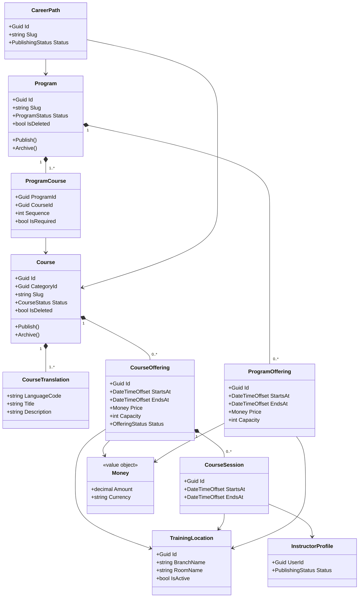
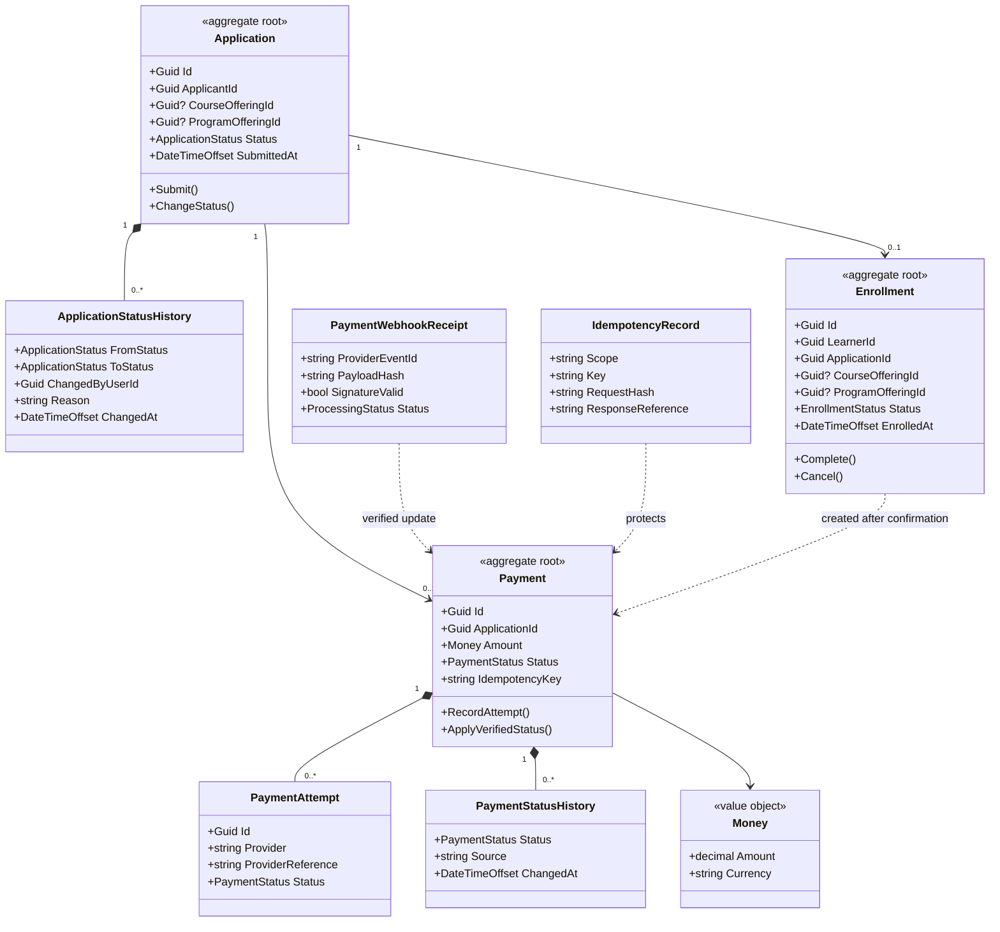
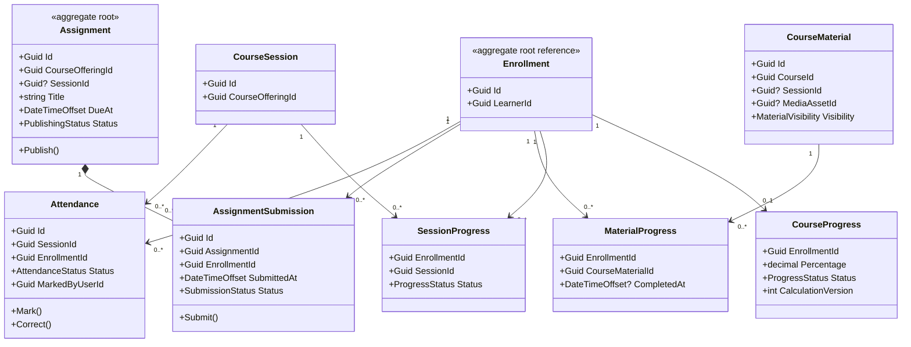
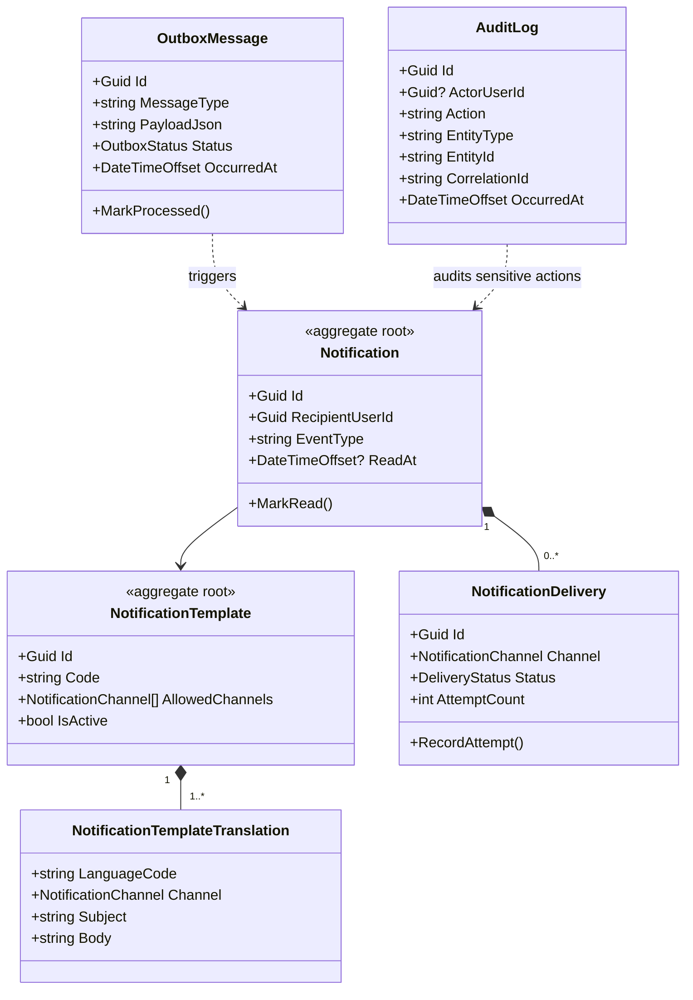

# Andalusia Academy Phase 1 Conceptual Class Diagrams

## Status and intent

These diagrams describe the intended Clean Architecture boundaries and the main Phase 1 domain relationships. They are not generated code and do not freeze constructors, methods, namespaces, or persistence mappings.

## 1. Solution boundaries

```mermaid
classDiagram
    namespace Domain {
        class DomainModel {
            <<business rules>>
        }
        class DomainEvents {
            <<contracts>>
        }
    }

    namespace Application {
        class Commands {
            <<use cases>>
        }
        class Queries {
            <<use cases>>
        }
        class Validators {
            <<input boundaries>>
        }
        class ApplicationInterfaces {
            <<ports>>
        }
    }

    namespace Infrastructure {
        class PersistenceAdapters {
            <<EF Core and SQL Server>>
        }
        class IdentityAdapters {
            <<ASP.NET Core Identity>>
        }
        class ProviderAdapters {
            <<payments, notifications, storage>>
        }
    }

    namespace API {
        class Controllers {
            <<thin HTTP endpoints>>
        }
        class Middleware {
            <<cross-cutting HTTP behavior>>
        }
        class CompositionRoot {
            <<dependency injection>>
        }
    }

    Commands --> DomainModel
    Queries --> DomainModel
    Commands --> ApplicationInterfaces
    Queries --> ApplicationInterfaces
    Validators --> Commands
    Validators --> Queries
    PersistenceAdapters ..|> ApplicationInterfaces
    IdentityAdapters ..|> ApplicationInterfaces
    ProviderAdapters ..|> ApplicationInterfaces
    Controllers --> Commands
    Controllers --> Queries
    CompositionRoot --> ApplicationInterfaces
    CompositionRoot --> PersistenceAdapters
    CompositionRoot --> IdentityAdapters
    CompositionRoot --> ProviderAdapters
    DomainModel --> DomainEvents
```



Required project dependency direction:

```text
Domain          -> no project dependency
Application     -> Domain
Infrastructure  -> Application + Domain
API             -> Application + Infrastructure
```

## 2. Catalog aggregate model



`Publish()` and `Archive()` represent responsibilities, not approved method signatures. Publishing rules must require the approved bilingual content and scheduling data.

## 3. Application, payment, and enrollment aggregates



Core invariants:

- `Application` and `Enrollment` each reference exactly one offering type.
- Browser input never marks a payment as paid.
- Payment initiation and webhook processing are retry-safe.
- Verified payment, enrollment creation, and the corresponding outbox event share a transaction where possible.
- Enrollment and financial history cannot be physically deleted.

> **⚠ BUSINESS RULE TO CONFIRM:** The allowed application, payment, and enrollment state transitions are not final.

## 4. LMS aggregate model



> **⚠ BUSINESS RULE TO CONFIRM:** `Correct()`, `Submit()`, and course-progress calculation cannot be finalized until attendance corrections, assignment resubmissions, scoring, and progress weights are approved.

## 5. Notification and reliability model



Notification delivery failure must not roll back a completed payment or enrollment transaction. Delivery workers and outbox consumers must be idempotent.

## Implementation gate

Before these concepts become C# classes:

1. Confirm aggregate ownership and transaction boundaries.
2. Confirm state machines and unresolved business rules.
3. Keep provider and EF Core concerns out of Domain.
4. Add only the classes needed by the current vertical slice.
5. Review the corresponding ERD constraints before generating a migration.
