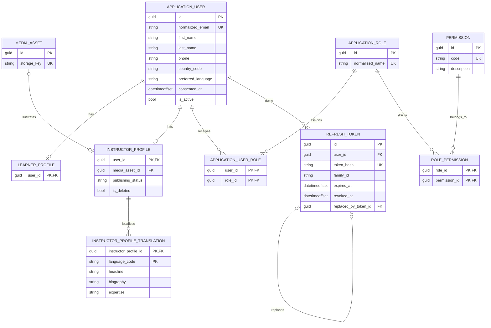
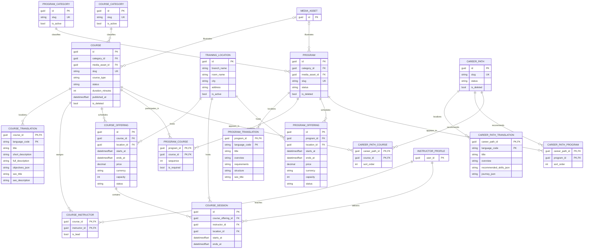
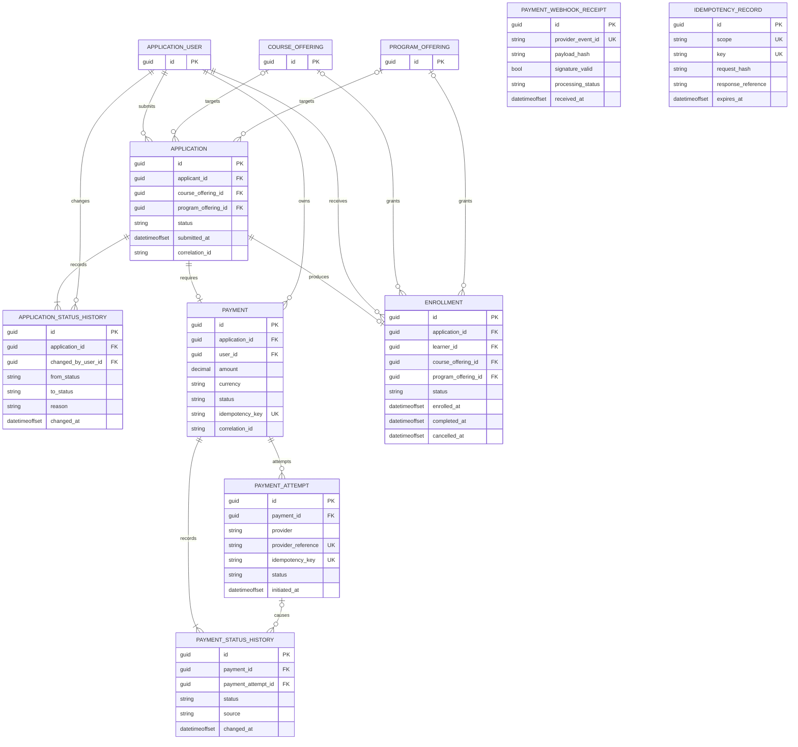
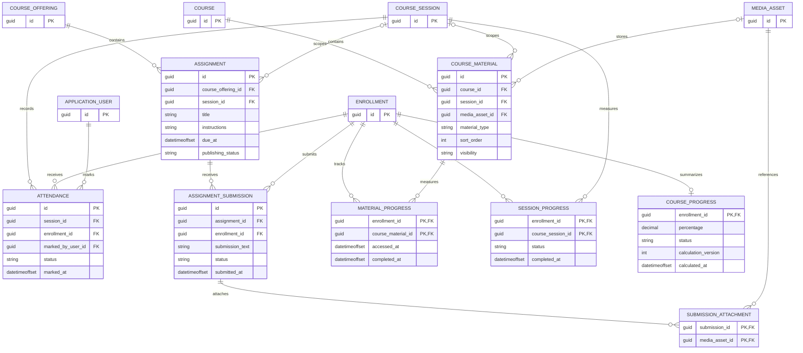

# Andalusia Academy Phase 1 Conceptual ERD

## Status and scope

This is the proposed conceptual entity-relationship model for the Phase 1 MVB. It is a design checkpoint, not an implemented database schema or migration contract.

The model covers the approved Phase 1 journey:

```text
Visitor -> Explore -> Apply -> Pay -> Enroll -> Learn -> Progress
```

It intentionally excludes Phase 2 capabilities such as direct messaging, assessments, quizzes, certificates, gamification, advanced analytics, and AI features.

## Data conventions

- Business identifiers use index-friendly `Guid` values.
- Business and audit timestamps use UTC `DateTimeOffset`.
- Money uses `decimal(18,2)` plus a three-character currency code.
- Arabic and English searchable content uses translation tables.
- Uploaded binaries remain outside SQL Server; `MediaAsset` stores metadata and a storage key.
- Payment, enrollment, attendance, progress, payout, and audit history is preserved.
- Important invariants must be enforced in SQL Server with keys, indexes, check constraints, and transactions.

## 1. Identity and authorization



ASP.NET Core Identity will also supply its standard claim, login, and token tables. Raw refresh tokens must never be stored.

## 2. Catalog and scheduling



> **⚠ BUSINESS RULE TO CONFIRM:** Determine whether related courses and programs are manually curated or calculated. The two career-path relationship tables are valid only when manual curation is required.

## 3. Applications, payments, and enrollment



Required database checks:

- An `Application` targets exactly one of `CourseOffering` or `ProgramOffering`.
- An `Enrollment` targets exactly one of `CourseOffering` or `ProgramOffering`.
- Every `Application` is created with its initial `ApplicationStatusHistory` record in the same transaction. The initial record has no previous status.
- Every `Payment` is created with its initial `PaymentStatusHistory` record in the same transaction. The initial record does not require a `PaymentAttempt`.
- Provider event IDs, provider references, and protected-write idempotency keys are unique within their defined scope.
- Enrollment history is never physically deleted.

> **⚠ BUSINESS RULE TO CONFIRM:** Admission states, manual-review rules, payment timing, free offerings, deposits or instalments, capacity reservation, refunds, cancellations, re-enrollment, and program-to-course access.

## 4. LMS Core



> **⚠ BUSINESS RULE TO CONFIRM:** Attendance correction, assignment resubmission, feedback or scoring, material-completion behavior, and the exact progress formula.

## 5. Operations, CMS, notifications, and reliability

```mermaid
erDiagram
    APPLICATION_USER {
        guid id PK
    }
    INSTRUCTOR_PROFILE {
        guid user_id PK
    }
    COURSE_OFFERING {
        guid id PK
    }
    PROGRAM_OFFERING {
        guid id PK
    }
    INSTRUCTOR_COMPENSATION {
        guid id PK
        guid instructor_id FK
        guid course_offering_id FK
        guid program_offering_id FK
        decimal amount
        string currency
        string status
    }
    PAYOUT {
        guid id PK
        guid instructor_id FK
        decimal total
        string currency
        string status
        datetimeoffset approved_at
        datetimeoffset paid_at
    }
    PAYOUT_LINE_ITEM {
        guid payout_id PK,FK
        guid compensation_id PK,FK
    }
    MEDIA_ASSET {
        guid id PK
        string storage_key UK
        string content_type
        long size_bytes
        string checksum
        guid owner_user_id FK
        bool is_deleted
    }
    CONTENT_PAGE {
        guid id PK
        string page_key UK
        string slug UK
        string status
        datetimeoffset published_at
    }
    CONTENT_PAGE_TRANSLATION {
        guid page_id PK,FK
        string language_code PK
        string title
        string body
        string seo_title
        string seo_description
    }
    HOMEPAGE_SECTION {
        guid id PK
        string section_type
        int sort_order
        bool is_enabled
        string status
    }
    HOMEPAGE_SECTION_TRANSLATION {
        guid section_id PK,FK
        string language_code PK
        string content_json
    }
    PARTNER {
        guid id PK
        guid media_asset_id FK
        string website_url
        int sort_order
        bool is_published
    }
    ACCREDITATION {
        guid id PK
        guid media_asset_id FK
        string status
        datetimeoffset valid_from
        datetimeoffset valid_to
    }
    FAQ {
        guid id PK
        string category
        int sort_order
        bool is_published
    }
    FAQ_TRANSLATION {
        guid faq_id PK,FK
        string language_code PK
        string question
        string answer
    }
    TESTIMONIAL {
        guid id PK
        guid media_asset_id FK
        string attribution
        datetimeoffset consented_at
        bool is_published
    }
    SITE_SETTING {
        guid id PK
        string setting_key UK
        string public_value
    }
    NOTIFICATION_TEMPLATE {
        guid id PK
        string code UK
        string allowed_channels
        bool is_active
    }
    NOTIFICATION_TEMPLATE_TRANSLATION {
        guid template_id PK,FK
        string language_code PK
        string channel PK
        string subject
        string body
    }
    NOTIFICATION {
        guid id PK
        guid recipient_user_id FK
        guid template_id FK
        string event_type
        string data_json
        datetimeoffset read_at
    }
    NOTIFICATION_DELIVERY {
        guid id PK
        guid notification_id FK
        string channel
        string status
        int attempt_count
        string provider_reference
    }
    OUTBOX_MESSAGE {
        guid id PK
        string message_type
        string payload_json
        string status
        datetimeoffset occurred_at
        datetimeoffset processed_at
    }
    AUDIT_LOG {
        guid id PK
        guid actor_user_id FK
        string action
        string entity_type
        string entity_id
        string correlation_id
        string safe_changes_json
        datetimeoffset occurred_at
    }

    INSTRUCTOR_PROFILE ||--o{ INSTRUCTOR_COMPENSATION : earns
    COURSE_OFFERING o|--o{ INSTRUCTOR_COMPENSATION : generates
    PROGRAM_OFFERING o|--o{ INSTRUCTOR_COMPENSATION : generates
    INSTRUCTOR_PROFILE ||--o{ PAYOUT : receives
    PAYOUT ||--o{ PAYOUT_LINE_ITEM : contains
    INSTRUCTOR_COMPENSATION ||--o| PAYOUT_LINE_ITEM : settles
    APPLICATION_USER o|--o{ MEDIA_ASSET : owns
    CONTENT_PAGE ||--o{ CONTENT_PAGE_TRANSLATION : localizes
    HOMEPAGE_SECTION ||--o{ HOMEPAGE_SECTION_TRANSLATION : localizes
    MEDIA_ASSET o|--o{ PARTNER : illustrates
    MEDIA_ASSET o|--o{ ACCREDITATION : illustrates
    FAQ ||--o{ FAQ_TRANSLATION : localizes
    MEDIA_ASSET o|--o{ TESTIMONIAL : illustrates
    NOTIFICATION_TEMPLATE ||--o{ NOTIFICATION_TEMPLATE_TRANSLATION : localizes
    APPLICATION_USER ||--o{ NOTIFICATION : receives
    NOTIFICATION_TEMPLATE ||--o{ NOTIFICATION : creates
    NOTIFICATION ||--o{ NOTIFICATION_DELIVERY : delivers
    APPLICATION_USER o|--o{ AUDIT_LOG : performs
```



`OutboxMessage` is intentionally independent in the conceptual ERD because it records events from multiple aggregates. Its payload must not contain secrets or unnecessary personal data.

> **⚠ BUSINESS RULE TO CONFIRM:** Compensation approval, payout workflow, editable CMS fields, content approval, notification channels, SMS provider, opt-out rules, and retention policies.

## Relationship summary

- One-to-one: user to learner profile, user to instructor profile, enrollment to course-progress summary.
- One-to-many: course to offerings, offering to sessions, application to one-or-more status-history records, payment to one-or-more status-history records, payment to attempts, and notification to delivery attempts.
- Many-to-many through explicit join entities: users to roles, roles to permissions, programs to courses, career paths to programs/courses, courses to instructors, submissions to media assets.
- Exclusive alternative targets: application, enrollment, and compensation target rules require SQL check constraints rather than polymorphic foreign keys.

## Implementation gate

Do not generate EF Core entities or migrations from this document until the listed business rules are reviewed and the physical schema, indexes, delete behaviors, concurrency strategy, and ownership boundaries are approved.
